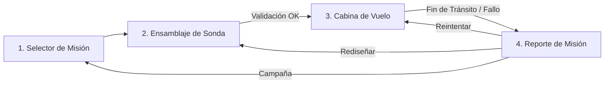

# Guía del Juego y Objetivos — Misión Crítica

**Misión Crítica** es un simulador de ingeniería espacial y operación de sondas en 2D pixel art. Combina la **planificación matemática de naves espaciales** con el **pilotaje táctico desde una cabina retro interactiva** donde debes gestionar combustible, electricidad y sensores científicos en tiempo real.

---

## En qué consiste el juego

Cada misión espacial pone a prueba dos habilidades complementarias:

1. **Ingeniería pre-vuelo (Fase de Ensamblaje)**:
   Construir una sonda capaz de alcanzar el objetivo sin exceder el presupuesto asignado, equilibrando:
   - **Propulsión y propelente ($\Delta v$)** según la ecuación del cohete de Tsiolkovski: cada kilogramo de paneles, baterías o sensores aumenta la masa seca y reduce el $\Delta v$ disponible.
   - **Balance eléctrico**: a mayor distancia del Sol (en Unidades Astronómicas, UA), los paneles solares generan menos vatios.
   - **Carga científica**: llevar instrumentos suficientes para obtener datos valiosos sin comprometer la llegada.

2. **Operación en vuelo (Cabina de Comandos)**:
   Una vez lanzada la sonda, tomas el control del panel de mando durante el tránsito hacia el objetivo:
   - **Controlar el encendido de motores** para quemar exactamente el $\Delta v$ requerido (ni quedarte corto ni pasarte del corredor orbital).
   - **Gestionar la energía eléctrica** desplegando paneles solares y apagando buses (`COMMS`, `CIENC` o `BUS MAES`) cuando entras en **zonas de sombra/eclipse** o **tormentas solares**.
   - **Capturar y transmitir ciencia** en el momento preciso de la **ventana de sobrevuelo** para lograr la máxima puntuación.

---

## Ciclo completo de una partida

### Paso 1: Elegir misión (`MissionSelectScreen`)
En la pantalla inicial se muestran las 3 misiones de la campaña con su presupuesto, $\Delta v$ requerido, tolerancia orbital, distancia solar (UA), TWR mínimo, duración del tránsito y récord científico alcanzado.

### Paso 2: Ensamblar la sonda (`AssemblyScreen`)
Partes siempre de un **Bus Base** (`120 kg`, `$15,000`, `12 W` de aviónica y `40 Wh` de batería interna) al que añades componentes en 4 categorías:
- **PROP (Propulsión)**: motores químicos o iónicos con distinto empuje e impulso específico ($I_{sp}$).
- **TANQ (Tanques)**: depósitos de propelente (`140 kg`, `320 kg` o `640 kg`).
- **ENER (Energía)**: paneles solares (`+45 W` o `+110 W` a 1.0 UA) y bancos de baterías (`120 Wh` o `260 Wh`).
- **INST (Instrumentos)**: cámara multiespectral (`+150 pts`), espectrómetro IR (`+250 pts`) y radar altimétrico SAR (`+350 pts`).

El botón **`AUTO-BASE`** carga una configuración recomendada válida para la misión seleccionada si deseas ir directo a volar o usarla como punto de partida.

Para poder presionar **`LANZAR SONDA >>`**, tu diseño debe cumplir obligatoriamente:
- Costo total $\le$ presupuesto de la misión.
- Al menos 1 motor instalado.
- Al menos 1 tanque de propelente instalado.

*(Las alertas amarillas advierten si tu $\Delta v$, TWR o balance energético están comprometidos, pero permiten intentar el lanzamiento).*

### Paso 3: Operar la cabina (`CockpitScreen`)

La cabina está dividida en 4 zonas operativas:

| Zona | Controles principales | Objetivo táctico |
| --- | --- | --- |
| **Ventana Principal** (Arriba) | Paralaje espacial, arco de trayectoria, planeta objetivo y alertas | Observar el avance (`0%`–`100%`), la entrada en ventana azul de sobrevuelo, eclipses (oscurecimiento) y tormentas solares (parpadeo ámbar). |
| **Energía y Sistemas** (Abajo izquierda) | Interruptores `BUS MAES`, `COMMS`, `CIENC`; medidor analógico; botón `DESPLEGAR PANELES` | **Desplegar paneles al inicio del vuelo** (empiezan replegados). Apagar `CIENC` o `COMMS` durante eclipses o tormentas solares para evitar un apagón. |
| **Consola Central** (Abajo centro) | Palanca `EMPUJE` (`0%`–`100%`), tapa de seguridad amarilla/negra, botón rojo `IGNICIÓN`, pantalla CRT | Abrir la tapa de seguridad, ajustar el empuje y pulsar ignición. Vigilar la barra del CRT para apagar el motor (`EMPUJE 0%` o pulsar ignición de nuevo) dentro del **corredor verde de $\Delta v$**. |
| **Ciencia y Telemetría** (Abajo derecha) | Radar, indicador de ventana, botones `CÁMARA`, `ESPECTRO`, `RADAR SAR` | Activar los sensores cuando el indicador pase a **`SOBREVUELO ¡CAPTURAR 100%!`** y mantener `COMMS` encendido hasta completar las barras de transmisión (`TX...` $\rightarrow$ `OK 100%`). |

---

## Objetivos y condiciones de victoria / fracaso

### Cómo ganar una misión (`VICTORY`)
Al completarse el tiempo de tránsito (`100%` de recorrido):
1. La sonda debe conservar batería por encima de `0 Wh`.
2. El $\Delta v$ quemado debe estar dentro del corredor objetivo:
   $$\Delta v_{\text{req}} - \text{tolerancia} \le \Delta v_{\text{quemado}} \le \Delta v_{\text{req}} + 2 \cdot \text{tolerancia}$$
3. **Objetivo secundario (Retorno Científico)**: capturar y transmitir los instrumentos durante la ventana de sobrevuelo (`100%` del valor) en lugar de hacerlo en tránsito lejano (`35%` del valor).

### Condiciones de fracaso
- **`FAILED_POWER` (Apagón total)**: la batería llega a `0 Wh` en cualquier instante del vuelo. Causa típica: olvidar desplegar los paneles solares o no racionar los buses en sombras/tormentas.
- **`FAILED_FUEL` (Propelente insuficiente)**: al final del tránsito no se alcanzó el $\Delta v$ mínimo y los tanques están vacíos.
- **`FAILED_MISSED_TARGET` (Maniobra fallida)**: al final del tránsito faltó impulso (con combustible aún en tanques) o se produjo un sobreimpulso excesivo por dejar el motor encendido demasiado tiempo.

---

## Misiones de la campaña

| # | Misión | Presupuesto | $\Delta v$ requerido | Distancia al Sol | Tránsito | Desafío principal |
| --- | --- | --- | --- | --- | --- | --- |
| **01** | **Órbita Baja Terrestre (LEO)** | `$110,000` | `950 ± 180 m/s` | `1.00 UA` (100% solar) | `40 s` | Tutorial: aprender tapa de seguridad, despliegue de paneles, corte de motor en corredor verde y captura en sobrevuelo (`65%`–`95%`). Incluye 1 eclipse (`35%`–`52%`). |
| **02** | **Sobrevuelo Lunar (Selene-I)** | `$145,000` | `2,200 ± 210 m/s` | `1.00 UA` (100% solar) | `52 s` | Equilibrar mayor masa de tanques/motor con reservas de batería para superar **dos zonas de sombra** (`28%`–`44%` y `58%`–`70%`) antes del periselene (`72%`–`95%`). |
| **03** | **Inserción en Marte (Ares-IV)** | `$195,000` | `3,500 ± 250 m/s` | `1.52 UA` (**43% solar**) | `64 s` | La potencia solar cae a menos de la mitad, cada kilogramo de instrumento penaliza el $\Delta v$ y ocurre una **tormenta solar** (`52%`–`67%`, `+15 W` de carga en bus científico) además de un eclipse (`30%`–`45%`). |

---

## Consejos rápidos de ingeniería y vuelo

1. **Al entrar en cabina**, despliega inmediatamente los paneles solares (`DESPLEGAR PANELES`) y luego abre la tapa de seguridad para iniciar tu quemado orbital.
2. **Para Marte (`1.52 UA`)**, el **Propulsor Iónico XEN-9 (`Isp 520s`)** aprovecha mucho mejor cada kilogramo de combustible que los motores químicos.
3. **Captura en ventana azul**: si activas un sensor antes de tiempo recibirás solo el `35%` de puntos; espera a la ventana de sobrevuelo para capturarlo (o recapturarlo) al `100%`.
4. **Raciona la energía**: durante un eclipse o tormenta solar, apaga el interruptor **`CIENC`** (y **`COMMS`** si no estás transmitiendo) para proteger la batería y vuelve a encenderlos al entrar en la ventana de sobrevuelo.
