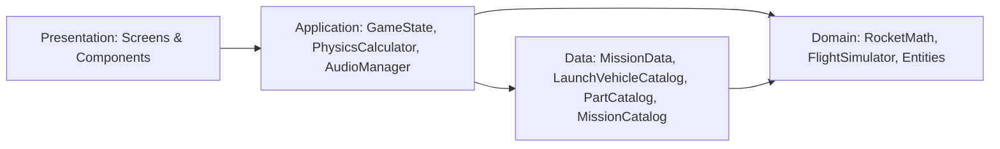

# Misión Crítica — Simulador de Misiones Espaciales (Godot 4.7 Pixel Art)

Simulador 2D en estilo **pixel art** con escena 2.5D (`1280x720` internos; ventana de `1920x1080`) desarrollado en **Godot 4.7** bajo una **arquitectura limpia** por capas (`domain`, `data`, `application`, `presentation`). Modela e integra de extremo a extremo las **9 exigencias contrapuestas de la ingeniería de misiones espaciales**:

1. **Objetivos de la misión**: retorno científico mínimo obligatorio (`min_science_required`) e instrumentos científicos requeridos (`required_instruments`) verificados tanto antes del despegue como en el desenlace de vuelo (`FAILED_OBJECTIVES` si no se capturan y descargan a Tierra).
2. **Diseño de la nave espacial**: arquitectura modular sobre bus octogonal (`ProbeDesign`) limitada por ranuras de cofia y visualizada en plano CAD dinámico (`ProbeBlueprintView`) y cabina espacial 360° (`ProbeVisualRenderer`).
3. **Instrumentos científicos**: compromiso real entre valor científico (`pts`), masa (`kg`), consumo eléctrico (`W`), costo (`$`) y volumen de datos generado (`MB`).
4. **Vehículos de lanzamiento**: 3 cohetes portadores seleccionables (`LaunchVehicleCatalog`: *Vega-C Ligero*, *Ariane-62 Medio*, *Vulcan-Centaur Pesado*) con compromiso entre costo, capacidad máxima de carga útil (`kg`), volumen de cofia (módulos máx.), inyección $\Delta v$ de etapa superior y dispersión orbital inicial.
5. **Presupuestos**: presupuesto unificado compartido entre **Cohete Lanzador + Bus Base + Propulsión + Tanques + Energía + Comunicaciones + Instrumentos**.
6. **Energía**: generación fotovoltaica inversamente proporcional al cuadrado de la distancia solar ($1 / d_{\text{UA}}^2$), orientación solar (`SOLAR -90°`), eclipses, tormentas y consumo eléctrico de buses y transpondedores.
7. **Masa**: masa seca + propelente gobernando el $\Delta v$ de Tsiolkovski, la relación empuje-peso (`TWR`) y el límite estructural estricto del cohete lanzador (`wet_mass_kg <= max_payload_kg`).
8. **Comunicaciones**: banda base (`18 kbps`) y antenas **Banda-X (`+42 kbps`)** / **Banda-Ka (`+95 kbps`)**, atenuación por distancia a Tierra independiente de la distancia al Sol, apuntado HGA y paquetes en MB. La conversión física es `kbps / 8000 = MB/s`; la descarga se acelera explícitamente `x9200` para partidas cortas.
9. **Limitaciones orbitales**: deriva orbital y ventanas **TCM (`PROGRADO 0°`)**, asistencia gravitatoria (**Honda Gravitatoria**), sobrevuelo científico (`OBJETIVO -35°`) e **Inserción Orbital (`RETRÓGRADO 180°`)**.

> **Documentación técnica para desarrolladores:** consulta la [**Guía del Desarrollador**](guia-desarrollador/README.md).
> **Manual del jugador y objetivos:** consulta la [**Guía del Juego y Objetivos**](GUIA-JUEGO-Y-OBJETIVOS.md).

**Primer vuelo automático:** selecciona una misión con **1-3**, pulsa **BASE [B]** y después **AUTOMÁTICO [F6]**. **MANUAL [F5]** permite pilotar. El piloto administra orientación, buses, maniobras, captura y descarga con los recursos del diseño. La cabina explica sus acciones y permite pasar a control manual con **AUTO: ON** o **M**. Los diseños inviables pueden fallar también en automático.

**Ayuda educativa:** **AYUDA** abre una guía con pausa que explica unidades, compromisos de diseño, operaciones y escalas temporales. Los motores consumen electricidad proporcional al acelerador (5 W, 8 W y 60 W a plena potencia). El XEN-9 y el resto del catálogo usan valores simplificados de juego; no son especificaciones reales. El resultado añade recomendaciones según la causa del fallo.

**Vista espacial 2.5D:** escena en el **70% superior** y cabina permanente en el **30% inferior**, tanto en manual como en automático. **V** o clic central muestra/oculta las ayudas. Partículas, rocas y satélites decorativos dan profundidad y movimiento incluso al viajar por inercia; el frenado reduce su velocidad visual. La Tierra se aleja y el destino crece y cambia de posición durante todo el tránsito, desde la salida y el Sol visible ilumina los cuerpos. Una brújula local y flechas de movimiento/empuje explican los giros. El informe ocupa la zona de cabina y conserva visible la órbita o deriva final. Las distancias y direcciones son esquemáticas; los objetos ambientales no afectan recursos ni provocan colisiones.

**Controles e interfaz:** teclas visibles en botones, foco de teclado ámbar, listas con rueda y tarjetas con nombres/descripciones ajustados. En ensamblaje: **1-6**, flechas y **+/-**; el plano admite zoom y arrastre. En vuelo: **A/D**, **1-5**, **W/Q**, **C** y **Espacio**; clic en escena orienta, derecho estabiliza y rueda ajusta empuje (**Shift** para precisión). **F1** abre la guía completa. La ventana conserva la proporción 16:9 y el título de misión tiene su propia fila para evitar solapamientos.

---

## Tabla de contenidos

1. [Arquitectura del sistema](#arquitectura-del-sistema)
2. [Requisitos previos](#requisitos-previos)
3. [Ejecución y flujo en Godot](#ejecución-y-flujo-en-godot)
4. [Pruebas automatizadas](#pruebas-automatizadas)
5. [Estructura del proyecto](#estructura-del-proyecto)
6. [Regeneración de assets pixel art y audio](#regeneración-de-assets-pixel-art-y-audio)

---

## Arquitectura del sistema



- **`src/domain/`**: Entidades (`LaunchVehicleSpec`, `PartSpec`, `MissionSpec`, `ProbeDesign`, `FlightTelemetry`) y lógica matemática/física pura (`RocketMath`, `FlightSimulator`) en `RefCounted`, sin dependencias de UI ni del `SceneTree`.
- **`src/data/`**: Catálogos estáticos (`LaunchVehicleCatalog`, `PartCatalog`, `MissionCatalog`) + Autoload `MissionData`.
- **`src/application/`**: Orquestación de estado (`GameState`), fachada de física (`PhysicsCalculator`) y audio chiptune (`AudioManager`).
- **`src/presentation/`**: Escenas `.tscn`, `ThemeFactory` (incluye generación procedural de íconos en memoria como respaldo), `ProbeVisualRenderer` y pantallas/componentes de cabina con terminales CRT desplazables (`ScrollContainer`).

---

## Requisitos previos

- **Godot Engine**: `4.7.x` (probado con `Godot_v4.7.2-stable_mono_linux.x86_64`).
- **Python 3**: Opcional, para regenerar los archivos `.png` / `.fnt` / `.wav` en `assets/` con `tools/generate_assets.py`.

---

## Ejecución y flujo en Godot

1. Abrir el proyecto (`project.godot`) en **Godot 4.7**.
2. Esperar a que finalice la importación de `assets/`.
3. Presionar **`F5`** para iniciar `res://src/presentation/screens/Main.tscn`.
4. En **Ensamblaje (`AssemblyScreen`)**, explora las 6 pestañas con **1-6** o utiliza **BASE [B]** para cargar la integración recomendada de la misión.
5. Elige **MANUAL [F5]** o **AUTOMÁTICO [F6]**. Consulta **AYUDA [F1]** en selección, ensamblaje o cabina.

---

## Pruebas automatizadas

```sh
# 1. Importar recursos en modo headless
godot --headless --import --quit

# 2. Pruebas unitarias de física, lanzadores, comunicaciones y simulador de vuelo
godot --headless --script res://tests/TestRunner.gd

# 3. Prueba de integración completa con Autoloads y escenas
godot --headless res://tests/IntegrationTest.tscn
```

---

## Estructura del proyecto

```text
misión-crítica/
├── project.godot                  # Configuración 1280x720, ventana 1920x1080, Nearest, Autoloads y Main.tscn
├── README.md                      # Documentación principal del repositorio
├── GUIA-JUEGO-Y-OBJETIVOS.md      # Manual del juego, 9 exigencias y controles
├── guia-desarrollador/            # Documentación técnica modular por capítulos
├── assets/
│   ├── audio/                     # Efectos chiptune (.wav)
│   ├── fonts/                     # Fuente bitmap 5x7 (.fnt + .png)
│   └── sprites/                   # Sprites UI, cabina, piezas y planetas
├── src/
│   ├── domain/
│   │   ├── entities/              # LaunchVehicleSpec, PartSpec, MissionSpec, ProbeDesign, FlightTelemetry
│   │   └── services/              # RocketMath, FlightSimulator
│   ├── data/                      # LaunchVehicleCatalog, PartCatalog, MissionCatalog, MissionData
│   ├── application/               # GameState, PhysicsCalculator, AudioManager
│   └── presentation/
│       ├── theme/                 # ThemeFactory
│       ├── components/            # Blueprint, ViewportWindow, Power, Nav, Science, Result
│       └── screens/               # Main, MissionSelectScreen, AssemblyScreen, CockpitScreen
├── tests/                         # TestRunner.gd e IntegrationTest.tscn
└── tools/                         # generate_assets.py
```

---

## Regeneración de assets pixel art y audio

```sh
python3 tools/generate_assets.py
godot --headless --import --quit
```
