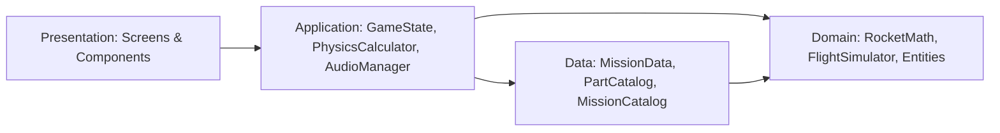

# Misión Crítica — Simulador de Misiones Espaciales (Godot 4.7 Pixel Art)

Simulador 2D en estilo **pixel art** (`640x360`) desarrollado en **Godot 4.7** bajo una **arquitectura limpia** por capas (`domain`, `data`, `application`, `presentation`). El jugador diseña sondas espaciales ajustándose a presupuestos y leyes reales de propulsión y energía, y posteriormente opera la misión desde una cabina interactiva retro con pantalla CRT, interruptores físicos, panel de sensores y ventana espacial con paralaje.

> **Documentación técnica para desarrolladores:** consulta la [**Guía del Desarrollador**](guia-desarrollador/README.md).
> **Manual del jugador y diseño del juego:** consulta la [**Guía del Juego y Objetivos**](GUIA-JUEGO-Y-OBJETIVOS.md).

---

## Tabla de contenidos

1. [Características principales](#características-principales)
2. [Arquitectura del sistema](#arquitectura-del-sistema)
3. [Requisitos previos](#requisitos-previos)
4. [Ejecución y flujo en Godot](#ejecución-y-flujo-en-godot)
5. [Pruebas automatizadas](#pruebas-automatizadas)
6. [Estructura del proyecto](#estructura-del-proyecto)
7. [Regeneración de assets pixel art y audio](#regeneración-de-assets-pixel-art-y-audio)

---

## Características principales

- **Renderizado Pixel Art nítido**: Viewport base `640x360` (16:9 exacto) con `stretch/mode="viewport"`, `stretch/aspect="keep"`, filtro `Nearest` por defecto y *pixel snapping* 2D sobre renderer `gl_compatibility`.
- **Motor físico-matemático puro (`RocketMath`)**:
  - Ecuación de Tsiolkovski: $\Delta v = I_{sp} \cdot g_0 \cdot \ln(m_0 / m_f)$ con $I_{sp}$ efectivo ponderado por empuje en configuraciones multimotor.
  - Relación empuje-peso (TWR) y validación de presupuesto.
  - Generación fotovoltaica dependiente de la distancia al Sol ($1 / d_{\text{UA}}^2$), eclipses y consumo por buses.
- **3 Pantallas jugables**:
  - **Selector de misiones (`MissionSelectScreen`)**: 3 misiones progresivas (*Órbita Baja Terrestre*, *Sobrevuelo Lunar*, *Inserción en Marte*).
  - **Ensamblaje de sonda (`AssemblyScreen`)**: Catálogo de 13 componentes en 4 categorías (`PROP`, `TANQ`, `ENER`, `INST`), plano esquemático dinámico (`ProbeBlueprintView`), botón `AUTO-BASE` y telemetría pre-vuelo en tiempo real.
  - **Cabina virtual interactiva (`CockpitScreen`)**: Ventana espacial con paralaje y partículas `CPUParticles2D`, panel de energía con interruptores `TextureButton` y medidor analógico de batería, consola central con monitor CRT, palanca de empuje y tapa de seguridad abatible, panel científico con radar `AnimatedSprite2D`, sacudida `Camera2D` y audio chiptune.
- **Previsualización en editor (`@tool`)**: Las pantallas y componentes se renderizan también en la vista **2D** del editor de Godot.

---

## Arquitectura del sistema



- **`src/domain/`**: Entidades y lógica matemática/física pura (`RefCounted`), sin dependencias de UI ni del `SceneTree`.
- **`src/data/`**: Catálogos estáticos de piezas y misiones + Autoload `MissionData`.
- **`src/application/`**: Orquestación de estado (`GameState`), fachada de física (`PhysicsCalculator`) y motor de audio (`AudioManager`).
- **`src/presentation/`**: Escenas `.tscn`, componentes visuales `Control` / `NinePatchRect`, `ThemeFactory` y recursos pixel art.

---

## Requisitos previos

- **Godot Engine**: `4.7.x` (probado con `Godot_v4.7.2-stable_mono_linux.x86_64`).
- **Python 3**: Opcional, únicamente necesario si se desea regenerar los sprites PNG, la fuente BMFont y los `.wav` mediante `tools/generate_assets.py`.

---

## Ejecución y flujo en Godot

1. Abrir la carpeta del proyecto (`project.godot`) en **Godot 4.7**.
2. Esperar a que finalice la importación inicial de `assets/` (o ejecutar en consola con `--import`).
3. Presionar **`F5`** (o el botón **▶** arriba a la derecha) para iniciar `res://src/presentation/screens/Main.tscn`.
4. Si en el panel embebido **Game** deseas ver la ventana independiente a escala `1280x720`, desmarca la opción *Embed Game* en la barra de la pestaña *Game*.

---

## Pruebas automatizadas

El proyecto incluye pruebas unitarias de dominio y pruebas de integración end-to-end en `SceneTree`:

```sh
# 1. Importar recursos en modo headless
godot --headless --import --quit

# 2. Pruebas unitarias de física, catálogos y simulador de vuelo
godot --headless --script res://tests/TestRunner.gd

# 3. Prueba de integración completa con Autoloads y escenas
godot --headless res://tests/IntegrationTest.tscn
```

---

## Estructura del proyecto

```text
misión-crítica/
├── project.godot                  # Configuración 640x360, Nearest, Autoloads y Main.tscn
├── README.md                      # Documentación principal del repositorio
├── GUIA-JUEGO-Y-OBJETIVOS.md      # Manual del juego, mecánicas y objetivos por misión
├── guia-desarrollador/            # Documentación técnica modular por capítulos
├── assets/
│   ├── audio/                     # Efectos chiptune (.wav)
│   ├── fonts/                     # Fuente bitmap 5x7 (.fnt + .png)
│   └── sprites/                   # Sprites UI, cabina, piezas y planetas
├── src/
│   ├── domain/
│   │   ├── entities/              # PartSpec, MissionSpec, ProbeDesign, FlightTelemetry
│   │   └── services/              # RocketMath, FlightSimulator
│   ├── data/                      # PartCatalog, MissionCatalog, MissionData
│   ├── application/               # GameState, PhysicsCalculator, AudioManager
│   └── presentation/
│       ├── theme/                 # ThemeFactory
│       ├── components/            # Blueprint, ViewportWindow, Power, Nav, Science, Result
│       └── screens/               # Main, MissionSelectScreen, AssemblyScreen, CockpitScreen
├── tests/                         # TestRunner.gd e IntegrationTest.tscn
└── tools/                         # generate_assets.py
```

---

## Regeneración de assets pixel art y audio

Todos los sprites, la fuente bitmap (`pixel_5x7.fnt`) y los efectos `.wav` se generan de forma determinista sin dependencias externas (solo biblioteca estándar de Python):

```sh
python3 tools/generate_assets.py
godot --headless --import --quit
```
