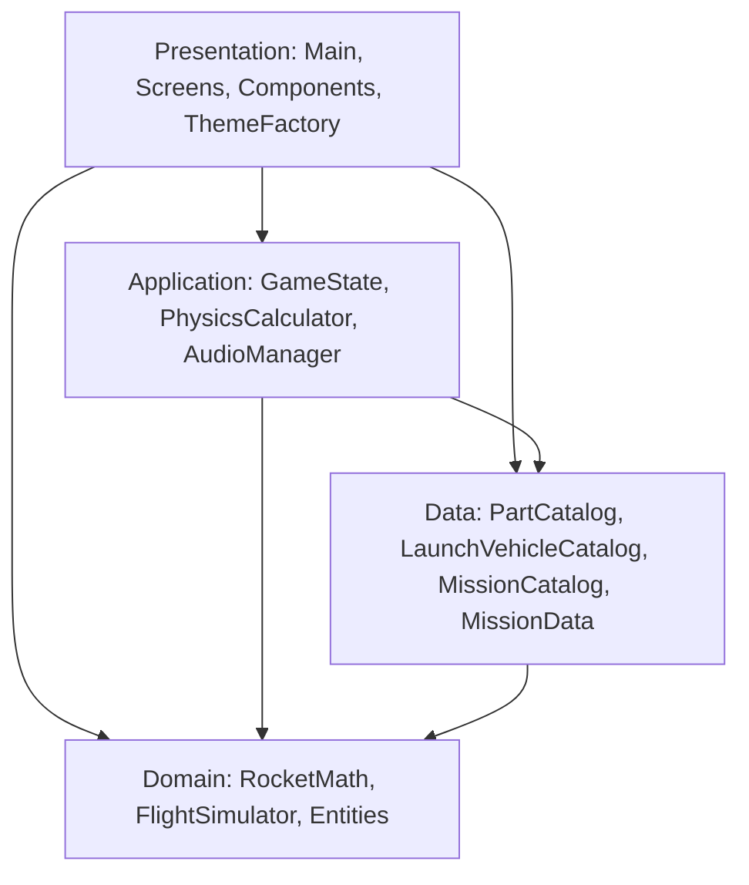

# 00 — Arquitectura y configuración

[Volver al índice](README.md)

## Capas y regla de dependencias

La regla central es unidireccional hacia **`src/domain/`**:

- **`src/domain/`** (`RefCounted` puro): no referencia `SceneTree`, `Control`, `Node2D` ni ningún Autoload. Puede instanciarse y probarse de forma aislada con `godot --headless --script`.
- **`src/data/`**: define las instancias concretas de piezas, vehículos de lanzamiento y misiones (`PartCatalog`, `LaunchVehicleCatalog`, `MissionCatalog`) y expone el Autoload `MissionData`.
- **`src/application/`**: coordina el estado de sesión (`GameState`), expone la fachada matemática (`PhysicsCalculator`) y gestiona el sonido (`AudioManager`).
- **`src/presentation/`**: traduce el estado del dominio/aplicación a nodos visuales (`Control`, `NinePatchRect`, `TextureButton`, `AnimatedSprite2D`, `Camera2D`, `CPUParticles2D`) y emite señales de entrada hacia `GameState` o `FlightSimulator`.

## Configuración del proyecto (`project.godot`)

| Sección / Clave | Valor configurado | Propósito |
| --- | --- | --- |
| `application/run/main_scene` | `res://src/presentation/screens/Main.tscn` | Escena raíz que enruta fases. |
| `display/window/size/viewport_width` | `1280` | Ancho lógico 16:9 para pixel art. |
| `display/window/size/viewport_height` | `720` | Alto lógico 16:9 (escala 1.5x a 1080p y 3x a 4K). |
| `display/window/size/window_width_override` | `1920` | Ventana Full HD. |
| `display/window/size/window_height_override` | `1080` | Ventana Full HD. |
| `display/window/stretch/mode` | `"viewport"` | Renderiza en framebuffer virtual `1280x720` antes de escalar. |
| `display/window/stretch/aspect` | `"keep"` | Preserva relación 16:9 sin deformación ni desenfoque. |
| `rendering/textures/canvas_textures/default_texture_filter` | `0` (`Nearest`) | Mantiene bordes duros en todos los sprites y fuentes bitmap. |
| `rendering/2d/snap/snap_2d_transforms_to_pixel` | `true` | Evita subpíxeles en nodos 2D y `Camera2D`. |
| `rendering/2d/snap/snap_2d_vertices_to_pixel` | `true` | Alinea vértices a la grilla de píxeles. |
| `rendering/renderer/rendering_method` | `"gl_compatibility"` | Compatibilidad amplia en Linux, Windows y WebAssembly/HTML5. |

## Autoloads (Singletons)

Registrados en `[autoload]` dentro de [project.godot](../project.godot) en el siguiente orden de inicialización:

| Autoload | Script | Responsabilidad |
| --- | --- | --- |
| `MissionData` | `res://src/data/MissionData.gd` | Carga en `_ready()` `PartCatalog.create_all()`, `LaunchVehicleCatalog.create_all()` y `MissionCatalog.create_all()`, indexando por `id`. |
| `PhysicsCalculator` | `res://src/application/PhysicsCalculator.gd` | Fachada sobre `RocketMath` para la capa de presentación y `GameState`. |
| `GameState` | `res://src/application/GameState.gd` | Posee `current_phase`, `current_mission`, `current_design`, `active_simulator`, `last_evaluation` y `completed_missions`. |
| `AudioManager` | `res://src/application/AudioManager.gd` | Pool de 6 `AudioStreamPlayer` para SFX + reproductores dedicados para motor y alarma de batería. |

> **Nota sobre scripts `@tool`**: En el editor de Godot los Autoloads no están instanciados en el `SceneTree` mientras se edita una escena. Por ello, los scripts `@tool` consultan directamente `PartCatalog`, `LaunchVehicleCatalog`, `MissionCatalog` o `RocketMath` cuando `Engine.is_editor_hint()` es verdadero.
