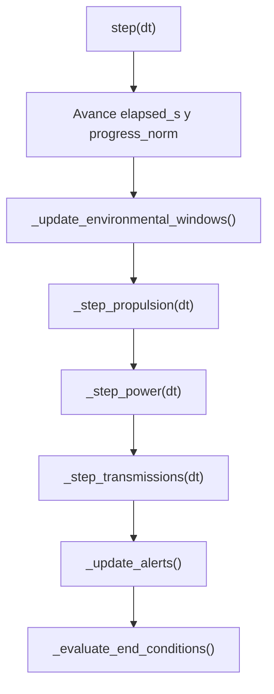

# 02 — Simulador de vuelo

[Volver al índice](README.md)

[FlightSimulator.gd](../src/domain/services/FlightSimulator.gd) ejecuta la simulación en tiempo real paso a paso mediante `step(dt: float)` operando exclusivamente sobre `MissionSpec`, una copia clonada de `ProbeDesign` y `FlightTelemetry`.

## Ciclo de ejecución (`step(dt)`)

### Escalas temporales de simulación

Para mantener maniobras jugables en sesiones de 40–64 segundos preservando exactamente las ecuaciones físicas:

| Constante | Valor | Efecto |
| --- | --- | --- |
| `BURN_TIME_SCALE` | `26.0` | Multiplica el gasto másico $\dot{m}$ por segundo real de juego; el paso $\Delta v$ se integra usando la diferencia exacta de masa $\ln(m_{\text{antes}} / m_{\text{después}})$, por lo que $\Delta v_{\text{burned}} + \Delta v_{\text{remaining}} = \Delta v_{\text{initial}}$ se conserva siempre. |
| `FLIGHT_HOURS_PER_REAL_SEC` | `0.06` | Convierte segundos reales de partida en horas de vuelo (`3.6 min/s`) para integrar potencia en vatios sobre la capacidad en `Wh` de las baterías. |

## Propulsión y seguridad de ignición

- La ignición requiere **simultáneamente**:
  1. `telemetry.status == IN_FLIGHT`
  2. `telemetry.safety_cover_open == true` (tapa de seguridad levantada)
  3. `telemetry.master_bus_on == true`
  4. `telemetry.propellant_remaining_kg > 0.0` y empuje instalado $> 0$
- Si al activar `trigger_ignition()` el `throttle` es menor a `0.15`, el simulador lo eleva automáticamente a `0.5` para ofrecer respuesta inmediata al jugador.
- Bajar `throttle` a `0.0`, cerrar la tapa de seguridad, apagar `master_bus_on` o agotar el propelente detienen `engine_firing`.

## Energía, ventanas ambientales y ciencia

- **Ventanas ambientales** (evaluadas sobre `progress_norm` en `[0.0, 1.0]`):
  - `shadow_windows`: anulan la generación fotovoltaica (`solar_gen_w = 0`).
  - `solar_storm_windows`: añaden `+15.0 W` de carga si `science_bus_on` está activo.
  - `flyby_window` (`flyby_window_start_norm .. flyby_window_end_norm`): determina la calidad de captura científica.
- **Captura científica (`activate_instrument(part_id)`)**:
  - Requiere `master_bus_on` y `science_bus_on` activos.
  - Dentro de la ventana de sobrevuelo otorga calidad `1.0` (`100%`); fuera de ella otorga `0.35` (`35%`). Un instrumento capturado al `35%` puede **recapturarse** al `100%` al entrar en ventana.
- **Transmisión (`_step_transmissions`)**:
  - Avanza a razón de `0.55 / s` (~`1.8 s` por instrumento) únicamente mientras `master_bus_on` y `comms_on` estén encendidos.
  - Al llegar a `1.0`, marca `instruments_transmitted[part_id] = true` y suma `round(science_value * quality)` a `telemetry.science_score`.

## Condiciones de fin de misión

| Estado `FlightTelemetry.Status` | Condición de disparo |
| --- | --- |
| `FAILED_POWER` | En cualquier instante en que `battery_wh <= 0.0`. |
| `FAILED_FUEL` | Al llegar `progress_norm >= 1.0` con `delta_v_burned < min_dv` y `propellant_remaining_kg <= 0.01`. |
| `FAILED_MISSED_TARGET` | Al llegar `progress_norm >= 1.0` con `delta_v_burned < min_dv` (con combustible sobrante) o `delta_v_burned > max_dv` (`required_delta_v + 2 * delta_v_tolerance`). |
| `VICTORY` | Al llegar `progress_norm >= 1.0` con `battery_wh > 0` y $\Delta v_{\text{burned}} \in [\text{min\_dv}, \text{max\_dv}]$. |
