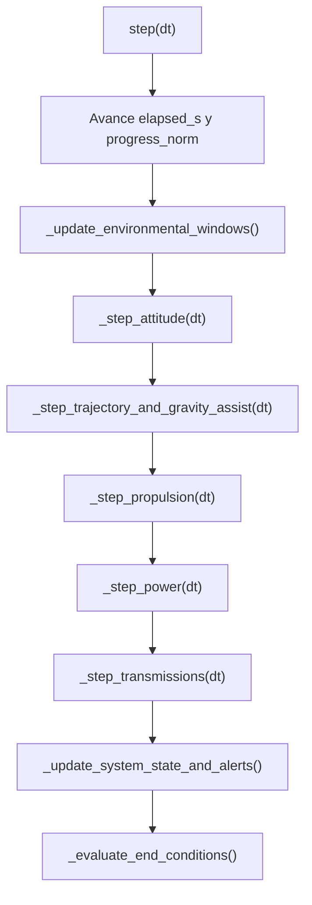

# 02 — Simulador de vuelo, actitud (ACS) y trayectoria

[Volver al índice](README.md)

[FlightSimulator.gd](../src/domain/services/FlightSimulator.gd) ejecuta la simulación determinista paso a paso mediante `step(dt: float)` operando exclusivamente sobre `MissionSpec`, una copia clonada de `ProbeDesign` y `FlightTelemetry`.

## Ciclo de ejecución (`step(dt)`)

## 1. Sistema de Control de Actitud (`_step_attitude`)

- **Actuadores**:
  - **Ruedas de reacción (`RW`)**: aceleración angular `55 °/s²` y velocidad máxima de giro `42 °/s` sin consumo de propelente (`+1.5 W` a `+7.0 W` eléctricos). Absorber perturbaciones externas (especialmente durante `in_solar_storm`) incrementa `rw_saturation` (`0.0 .. 1.0`). Al llegar a `1.0`, pierden par hasta ser desaturadas.
  - **Propulsores RCS (`rcs_enabled`)**: suman `105 °/s²` (`78 °/s` máx.), desaturan automáticamente `rw_saturation` (`-0.32 / s`) y consumen micro-pulsos de propelente, activando `rcs_active_jets` para el renderizado de chorros en las esquinas del bus.
- **Modos de orientación (`FlightTelemetry.AttitudeMode`)**:
  - `PROGRADE (0°)`: alinea el motor principal para correcciones `TCM`.
  - `RETROGRADE (180°)`: rota la sonda 180° (motor hacia adelante) para el frenado de inserción orbital.
  - `SOLAR (-90°)`: maximiza `solar_pointing_factor = 1.0` (`100%` generación solar; cae a `25%` si entra en giro descontrolado `is_tumbling`).
  - `EARTH (+90°)`: alinea la antena parabólica de alta ganancia (`comms_link_factor = 1.0`, vs `0.32` omnidireccional o `0.0` si `is_tumbling`).
  - `TARGET (-35°)`: activa `target_pointing_ok = true`, desbloqueando calidad `1.0` (`100%`) en sensores durante `in_flyby_window` (frente a `0.60` desalineado o `0.35` fuera de ventana).
  - `HOLD` (`stabilize_attitude()`) y `MANUAL` (`set_manual_rotation` / `nudge_attitude`).

## 2. Control de Trayectoria, Honda Gravitatoria e Inserción 180°

- **Crucero inercial y TCM (`PROGRADO 0°`)**:
  - La sonda inicia con una dispersión orbital heredada del vehículo lanzador (`launch_vehicle.injection_dispersion_km`, o `mission.initial_trajectory_error_km` como respaldo) y su etapa superior reduce el frenado requerido al llegar (`insertion_dv_target = max(250, insertion_dv_required - launch_injection_dv)`). Durante `tcm_windows` y tormentas solares la órbita sufre deriva.
  - Encender brevemente el motor alineado en `PROGRADE` ($\cos\theta \ge 0.70$) reduce `trajectory_error_km` a razón de `24 km` por cada `100 m/s` de $\Delta v$. Encender desalineado incrementa el desvío y marca `wrong_burn_direction = true`.
- **Asistencia Gravitatoria (`has_gravity_assist`)**:
  - Al cruzar el punto medio de `gravity_assist_window`:
	- Si `trajectory_error_km <= 24 km`, otorga el `100%` de `gravity_assist_dv_bonus` sin consumir propelente.
	- Si `24 km < trajectory_error_km <= max_trajectory_error_km`, otorga el `55%`.
  - El $\Delta v$ ganado se descuenta de `insertion_dv_target` (`max(250, insertion_dv_required - launch_injection_dv - bonus)`).
- **Comunicaciones y descarga de paquetes (`_step_transmissions`)**:
  - Calcula `downlink_kbps = RocketMath.calculate_effective_comms_kbps(design, mission.earth_distance_au) * telemetry.comms_link_factor`, con distancia a Tierra independiente del Sol y límite de transmisor.
  - Convierte `kbps / 8000` a `MB/s`, aplica escala de datos explícita `x9200` y reparte esa tasa entre los paquetes pendientes según su tamaño `part.data_volume_mb`.
- **Inserción Orbital (`RETRÓGRADO 180°`)**:
  - Al entrar en `insertion_window_start_norm`, el quemado útil de frenado exige estar orientado a `180°` ($-\cos\theta \ge 0.70$), acumulando `insertion_dv_burned` hasta alcanzar el corredor `[insertion_dv_target - delta_v_tolerance, insertion_dv_target + 1.8 * delta_v_tolerance]`.

## 3. Clasificación de Estados (`FlightTelemetry.SystemState`)

| Estado | Condiciones representativas |
| --- | --- |
| `STABLE` (`ESTABLE`) | Actitud alineada, sin giro excesivo, batería `>= 45%`, paneles desplegados y `trajectory_error_km <= 14 km`. |
| `CAUTION` (`PRECAUCIÓN`) | Maniobra de rotación en curso, eclipse/tormenta solar, paneles replegados, batería `25%–45%`, `rw_saturation >= 65%`, desvío `> 14 km` o frenado de inserción pendiente. |
| `CRITICAL` (`CRÍTICO`) | Bus maestro apagado, batería `< 25%`, giro rápido sin control, ruedas saturadas sin RCS, `wrong_burn_direction` con motor activo, desvío `> 85%` del límite o llegada inminente sin frenar a `180°`. |

`is_tumbling` indica velocidad angular elevada y sigue limitando captura, radio y quemado mientras se gira. `is_controlled_slew()` distingue un giro comandado con actuadores disponibles: se muestra como CAUTION, ORIENTANDO NAVE, en lugar de anunciar pérdida de control. Giros manuales descontrolados o sin actuadores mantienen CRITICAL.

## 4. Condiciones de fin de misión

| Estado `FlightTelemetry.Status` | Condición de disparo |
| --- | --- |
| `FAILED_POWER` | En cualquier instante en que `battery_wh <= 0.0`. |
| `FAILED_FUEL` | Al llegar `progress_norm >= 1.0` con `insertion_dv_burned < min_ins` y `propellant_remaining_kg <= 0.05`. |
| `FAILED_MISSED_TARGET` | Desvío orbital final `> max_trajectory_error_km`, falta de frenado a `180°` (la sonda sigue de largo y se pierde en el espacio) o sobrefrenado atmosférico (`> max_ins`). |
| `FAILED_OBJECTIVES` | Órbita lograda, pero falta transmitir algún instrumento obligatorio (`mission.required_instruments`) o `science_score < mission.min_science_required`. |
| `VICTORY` | `battery_wh > 0`, órbita insertada sin desvío excesivo, instrumentos obligatorios descargados y `science_score >= mission.min_science_required`. |

## 5. Piloto automático y escalas educativas

`GameState.launch_mission(automatic: bool = false)` valida el diseño antes de crear el simulador. `FlightSimulator.set_automatic_enabled(bool)` permite cambiar de modo durante el vuelo y detiene el motor al cambiar.

Con AUTO activo, `step(dt)` subdivide el tiempo en intervalos de hasta `1/60 s`, llama `MissionAutopilot.update(sim, dt)` y ejecuta el mismo motor de vuelo. El piloto emplea únicamente comandos de orientación, buses, paneles, motor y sensores; no modifica recursos ni resultados. Prioriza inserción, corrección TCM, captura óptima, descarga y crucero solar. Ajusta los pulsos por masa, empuje y delta-v restante. `automatic_action` y la bitácora explican cada fase. Diseños sin recursos pueden fallar.

Los modos manuales siguen disponibles; una acción manual desde la cabina desactiva AUTO. Reintentar crea otra cabina y otro simulador conservando el modo. La guía `LearningOverlay` pausa el árbol y conserva el estado de pausa anterior al cerrarse.

La generación usa distancia al Sol y la radio distancia a Tierra. El consumo eléctrico incluye `power_draw_w * throttle` de motores cuando disparan. Los parámetros de motores son ficticios/simplificados y el juego utiliza escalas independientes: quemado `x45`, electricidad `0.06 horas/s de juego` y datos `x9200`. No deben interpretarse como un reloj físico único.
