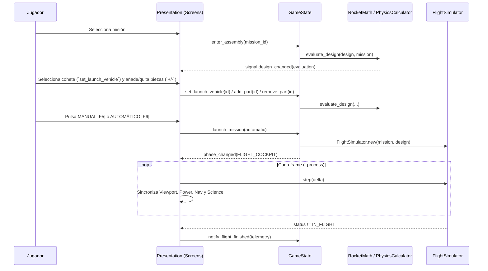

# 05 — Mapa de directorios y flujos

[Volver al índice](README.md)

## Dónde vive cada responsabilidad

| Ruta desde la raíz | Responsabilidad |
| --- | --- |
| `project.godot` | Configuración del motor (`1280x720` internos, ventana `1920x1080`, `Nearest`), escena principal y Autoloads. |
| `src/domain/entities/` | Modelos puros `PartSpec`, `LaunchVehicleSpec`, `MissionSpec`, `ProbeDesign` y `FlightTelemetry`. |
| `src/domain/services/` | Lógica física (`RocketMath`), marco NASA/GMAT (`NasaMissionFramework`), simulación (`FlightSimulator`), piloto (`MissionAutopilot`) y localización (`Loc`). |
| `src/data/` | Catálogos (`PartCatalog`, `LaunchVehicleCatalog`, `MissionCatalog`) y Autoload `MissionData`. |
| `src/application/` | Estado de campaña (`GameState`), fachada (`PhysicsCalculator`) y audio (`AudioManager`). |
| `src/presentation/theme/` | `ThemeFactory` (tema retro, NinePatch, SpriteFrames). |
| `src/presentation/components/` | Plano de sonda, cabina, informe (`MissionResultOverlay`) y guía educativa con pausa (`LearningOverlay`). |
| `src/presentation/screens/` | Pantallas principales (`Main`, `MissionSelectScreen`, `AssemblyScreen` con modal NASA/GMAT `[N]`, `CockpitScreen`). |
| `assets/` | Sprites PNG, fuentes BMFont (`pixel_ui` / `pixel_5x7`), scripts GMAT de referencia (`nasa_gmat/`) y audio WAV generados. |
| `tools/` | Script `generate_assets.py` de generación determinista de recursos. |
| `tests/` | Suite unitaria (`TestRunner.gd`) y prueba de integración (`IntegrationTest.tscn`). |
| `guia-desarrollador/` | Documentación técnica de arquitectura y módulos. |

## Flujo de datos entre fases

## Criterio para extender el proyecto

- **Añadir una nueva pieza**: agregar una entrada `PartSpec.new({...})` en [PartCatalog.gd](../src/data/PartCatalog.gd), añadir su sprite `16x16` en `tools/generate_assets.py` con clave `part_<id>` y regenerar/reimportar assets. Si es un nuevo instrumento activable en cabina, añadir su fila en `_sensor_rows` de [SciencePanel.gd](../src/presentation/components/SciencePanel.gd).
- **Añadir una nueva misión**: agregar una entrada `MissionSpec.new({...})` en [MissionCatalog.gd](../src/data/MissionCatalog.gd) y su configuración base opcional en `GameState.load_recommended_baseline()`. Si introduce un nuevo `target_palette`, generar `planet_<palette>.png` en `tools/generate_assets.py`.
- **Añadir una nueva ecuación física**: implementarla como método estático en [RocketMath.gd](../src/domain/services/RocketMath.gd), exponerla si hace falta en [PhysicsCalculator.gd](../src/application/PhysicsCalculator.gd) y cubrirla con aserciones en [TestRunner.gd](../tests/TestRunner.gd).
